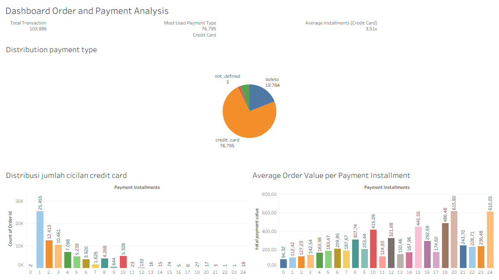

# Order and Payment Analysis Olist Dataset

## Project Overview

This project explores customer payment behavior on Olist's e-commerce platform using the Olist Brazilian E-Commerce dataset.

The analysis focuses on three areas: the most commonly used payment methods, customer preferences for credit card installments, and the relationship between the number of installments and average payment value.

Through this analysis, I aim to understand how customers pay for their orders and identify patterns in their payment preferences.

## Business Objectives

This project covers three business cases related to customer payment behavior.

### Business Case 1: Payment Method Analysis

**Objective:** Identify the most commonly used payment methods by comparing the number of orders and total payment value across different payment types.

### Business Case 2: Credit Card Installment Distribution

**Objective:** Understand customer preferences for credit card installments by examining how orders are distributed across different installment options.

### Business Case 3: Installments vs. Average Payment Value

**Objective:** Explore the relationship between the number of credit card installments and average payment value to see whether orders with more installments tend to have higher payment values.

## Dataset

This project uses the [Olist Brazilian E-Commerce Public Dataset](https://www.kaggle.com/datasets/olistbr/brazilian-ecommerce), which contains information about orders, products, customers, payments, and sellers.

**Main Table Used:**
- `order_payments_dataset`

**Data Scope:**
- The analysis includes payment records available in the dataset without filtering by `order_status`.
- Credit card payments are selected for the installment distribution analysis.
- An order may have multiple payment records or payment methods, so order counts across payment types may overlap.

## Tools & Technologies

- Python
- Pandas
- NumPy
- Matplotlib
- Seaborn
- Jupyter Notebook
- Tableau

## Analysis Workflow

1. **Import Libraries** — Import the Python libraries needed for data analysis and visualization.
2. **Data Gathering** — Load the datasets used throughout the analysis.
3. **Data Understanding** — Explore the dataset structure, dimensions, column names, and data types.
4. **Data Quality Assessment & Cleaning** — Check for missing values, duplicates, and other data quality issues, then handle them where necessary.
5. **Data Preparation** — Prepare the data for analysis through filtering, grouping, and aggregation.
6. **Exploratory Data Analysis (EDA)** — Explore payment methods, credit card installment patterns, and the relationship between installments and average payment value.
7. **Key Insights** — Highlight the main findings from each business case.
8. **Business Implications** — Discuss what the findings could mean for payment options and customer payment preferences.

## Key Findings

### Business Case 1: Payment Method Analysis

- Credit card was the most commonly used payment method, appearing in **76,505 orders**, with a total payment value of **R$12,542,084.19**.
- Boleto ranked second, appearing in **19,784 orders**, with a total payment value of **R$2,869,361.27**.
- Credit card and boleto were the two most frequently used payment methods among the available options.

### Business Case 2: Credit Card Installment Distribution

- Paying in a single installment was the most common choice, with **25,407 orders**, representing **33.14%** of the analyzed credit card orders.
- The number of orders generally decreased as the installment count increased.
- Ten-installment payments still accounted for **5,315 orders**, showing that customers also make use of longer installment plans.

### Business Case 3: Installments vs. Average Payment Value

- The analysis found a **moderate positive correlation of 0.60** between the number of installments and average payment value.
- Average payment value generally increased across higher installment counts, although the pattern was not consistent for every installment option.
- Orders with 10 installments recorded an average payment value of **R$416.10**, compared with **R$120.41** for single-installment payments.

## Dashboard Preview

The dashboard brings together the main findings from this analysis, covering payment method performance, credit card installment distribution, and the relationship between installments and average payment value.

### Interactive Dashboard

**[View the Interactive Dashboard on Tableau Public](https://public.tableau.com/app/profile/adin4572/viz/DashboardOrderandPaymentAnalysis/Dashboard1)**

### Dashboard Screenshot



## Business Implications

The findings offer a few areas worth looking into:

- **Payment Method Preferences:** Credit cards are the most frequently used payment method. Maintaining a smooth and reliable credit card payment experience is therefore important.
- **Installment Options:** Single-installment payments are the most common choice, but the usage of longer installment plans shows that customers also make use of flexible payment options.
- **Higher-Value Transactions:** Orders with more installments tend to have higher average payment values. This pattern may be useful when evaluating installment options for higher-value purchases, although other factors may also influence payment value.

## Repository Structure

```text
Olist-Order-and-Payment/
├── README.md
├── Order & Payment Analysis.ipynb
└── Dashboard/
    └── Dashboard_Order_and_Payment_Analysis.png
```

## Conclusion

This project provides an overview of customer payment behavior on Olist, from the payment methods they use to the installment options they choose.

Credit cards are the most commonly used payment method, while single-installment payments remain the most popular choice among credit card transactions. The analysis also shows a moderate positive relationship between installment count and average payment value.

These findings provide a starting point for understanding customer payment preferences and evaluating the role of installment options in e-commerce transactions.

## Project Category

**Data Analysis | E-Commerce | Order & Payment Analysis**

**Dataset:** Olist Brazilian E-Commerce Public Dataset
